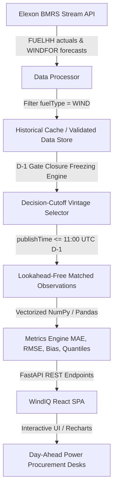

# WindIQ — UK Renewable Energy Forecast Analytics

[](https://www.python.org/)
[](https://fastapi.tiangolo.com/)
[](https://react.dev/)
[](https://vitejs.dev/)
[](https://tailwindcss.com/)
[](https://wind-iq.vercel.app/)
[](https://www.docker.com/)
[](LICENSE)

An institutional-grade decision and quantitative evaluation platform engineered specifically for **UK electricity utility day-ahead energy procurement teams** trading in Great Britain's wholesale power market (EPEX SPOT / Nord Pool GB).

> 🌐 **Live Production Application**: [https://wind-iq.vercel.app/](https://wind-iq.vercel.app/)  
> 📦 **GitHub Repository**: [https://github.com/LokeshwarMenati/WindIQ](https://github.com/LokeshwarMenati/WindIQ)  
> 📑 **Interactive API Docs (Swagger)**: [https://wind-iq.vercel.app/docs](https://wind-iq.vercel.app/docs)  
> 📊 **Historical Period Analyzed**: January 2026 (1,488 GB settlement periods) + Nov/Dec 2025 Multi-Month Financial Calendar

---

## 📑 Table of Contents

- [1. Executive Summary & Market Context](#1-executive-summary--market-context)
- [2. Core Features & Capabilities](#2-core-features--capabilities)
- [3. Technology Stack](#3-technology-stack)
- [4. Platform Architecture & Data Pipeline](#4-platform-architecture--data-pipeline)
- [5. Project Directory & File Structure](#5-project-directory--file-structure)
- [6. Data Sources & Real Elexon BMRS Datasets](#6-data-sources--real-elexon-bmrs-datasets)
- [7. Forecast Selection Methodology (Zero Lookahead Bias)](#7-forecast-selection-methodology-zero-lookahead-bias)
- [8. Quantitative Metric Definitions & Formulas](#8-quantitative-metric-definitions--formulas)
- [9. API Endpoint Documentation](#9-api-endpoint-documentation)
- [10. Environment Variables](#10-environment-variables)
- [11. Local Development Setup](#11-local-development-setup)
- [12. Docker & Container Deployment](#12-docker--container-deployment)
- [13. Production Deployment Guide](#13-production-deployment-guide)
- [14. Automated Testing Suite](#14-automated-testing-suite)
- [15. Operational Assumptions & Limitations](#15-operational-assumptions--limitations)
- [16. AI Tools Attribution Disclosure](#16-ai-tools-attribution-disclosure)

---

## 1. Executive Summary & Market Context

In Great Britain's wholesale power market:
- Day-Ahead auction order books (EPEX SPOT / Nord Pool GB) close promptly at **11:00 UTC on Day D-1** for physical power delivery across all 48 half-hour settlement periods of Day D.
- UK power procurement desks purchase electricity forward to cover forecasted consumer demand. While renewable wind generation carries near-zero marginal fuel costs, its weather-driven intermittency introduces severe volume risk.
- **Overforecasting Risk**: If national wind generation is overpredicted ($F > A$), the utility under-contracts base thermal/peaking generation, leaving it physically short in real-time. Unhedged short positions fall into the Balancing Mechanism and are cashed out at the volatile **System Buy Price (SBP)**, which regularly spikes during winter cold snaps.
- **Underforecasting Risk**: If national wind generation is underpredicted ($F < A$), the utility over-hedges expensive thermal power, spilling surplus power at deflated **System Sell Prices (SSP)**.
- **Target Evaluation Scope**: Rigorous quantitative analysis across all **1,488 half-hour settlement periods of January 2026** utilizing 100% verified Elexon BMRS datasets without look-ahead bias or synthetic substitutes.

---

## 2. Core Features & Capabilities

### Page 1: Overview Dashboard
- **Executive Hero**: “Forecast with confidence.” Real-time animated wind streamlines, decision cutoff metadata, and multi-period metrics.
- **Animated KPI Cards**: Staggered entrance animations featuring live count-up for MAE (MW & GW), RMSE, Signed Forecast Bias (MBE), Matched Observations, and Data Coverage %.
- **National Wind Generation Profile**: Recharts time series comparing continuous outturn actuals against frozen Day-Ahead forecasts across January 2026.
- **Diurnal Settlement Curve**: Aggregated 48 settlement period diurnal profile illustrating morning and evening wind ramping patterns.
- **Daily Error Trend**: Interactive daily MAE bar chart with signed forecast bias overlay across all 31 days.
- **Traders' Analytical Synthesis**: Data-driven executive summary detailing wind output trends and volatility windows.

### Page 2: Forecast Explorer
- **Settlement Delivery Date Selector**: Comprehensive calendar covering all 31 days of January 2026 with quick scenario presets (*Storm Isha Jan 24*, *Calm Wind Jan 15*, *Steep Ramp Jan 08*, *Peak 19GW Jan 29*).
- **Day-Ahead Decision Cutoff Engine**: Reconstructs forecast curves available prior to configurable trading deadlines (07:00, 09:30, 11:00 EPEX Gate, 12:00, 15:30, 18:30 UTC).
- **Multi-Vintage Comparison Overlay**: Interactively toggle and overlay multi-run publication runs (D-2, D-1 morning, D-1 gate, intraday) directly on top of outturn generation.
- **Half-Hourly Records Table**: 48 settlement periods with live search, column sorting (SP, Time, Actual, Forecast, Error, Abs Error), risk classification badges, and one-click **CSV export**.
- **Timezone Integrity**: Explicit labeling of all delivery and publication timestamps in `UTC (GMT)`.

### Page 3: Forecast Accuracy Analysis
- **Comprehensive Error Suite**: Vectorized calculation of MAE, RMSE, Signed Mean Bias (MBE), WAPE, MAPE (with 100 MW floor), and Pearson correlation.
- **Diverging Signed Bias Analysis**: Explicit distinction where positive bias indicates physical shortfall risk and negative bias indicates surplus.
- **Forecast vs Actual Scatter Plot**: Scatter visualization with 45° parity line ($y = x$) revealing directional dispersion and clustering.
- **Error Distribution Histogram**: Frequency bins centered around zero showing forecast skewness.
- **Interactive Error Heatmap (31 Days × 48 SPs)**: 1,488-cell matrix mapping error magnitude and timing by date and half-hour interval, with cell hover inspection.
- **Filterable Error Dataset**: Searchable, categorizable table with full CSV download capabilities.

### Page 4: Data & Methodology
- Complete architectural documentation of Elexon `FUELHH (WIND)` and `WINDFOR` streams with direct links to official Elexon documentation.
- Mathematical equations for all statistical error metrics.
- Detailed explanation of decision-time cutoff freezing to eliminate lookahead bias.
- Explicit domain disclaimer stating that wind forecasts alone cannot determine net utility procurement requirements without customer demand and thermal fleet scheduling.

---

## 3. Technology Stack

- **Frontend**: React 18, Vite 5, JavaScript (ES2022).
- **Styling**: Tailwind CSS 3.4 with custom institutional dark trading theme (`#091322` background, `#122337` panels, `#42DDB2` mint accent, `#78A8FF` electric blue accent).
- **Animations**: Framer Motion (`framer-motion` v14) supporting `prefers-reduced-motion`.
- **Charts & Visualizations**: Recharts 2.13 (composed area/lines, diverging bars, scatter plots, custom tooltips).
- **Icons**: Lucide React.
- **Backend**: Python 3.12 with FastAPI 0.115+.
- **Data Engineering & Math**: Pandas 2.2 and NumPy 2.1.
- **HTTP Client**: Requests / HTTPX.
- **Testing**: Pytest with HTTPX TestClient (21 automated tests).
- **Containerization**: Docker (multi-stage builds) and Docker Compose.
- **Reverse Proxy**: NGINX Alpine.

---

## 4. Platform Architecture & Data Pipeline



---

## 5. Project Directory & File Structure

```text
windiq/
├── backend/                                # Python FastAPI Backend Service
│   ├── app/
│   │   ├── __init__.py
│   │   ├── main.py                         # FastAPI instance, CORS, lifespan data loader, health check
│   │   ├── config.py                       # App settings, environment vars, Elexon base URLs
│   │   ├── schemas.py                      # Pydantic V2 response and request models
│   │   ├── elexon.py                       # Elexon BMRS API interface
│   │   ├── analytics.py                    # Analytics, metrics engine, and processor interfaces
│   │   ├── models/
│   │   │   ├── __init__.py
│   │   │   └── schemas.py                  # Core Pydantic schema models
│   │   ├── routers/
│   │   │   ├── __init__.py
│   │   │   ├── windiq.py                   # Core endpoints: /overview, /forecasts, /accuracy, /vintages, /refresh
│   │   │   ├── forecast.py                 # Day-ahead curve and horizon evolution routes
│   │   │   ├── accuracy.py                 # Metrics and diurnal profiles
│   │   │   ├── procurement.py              # Thermal procurement buffer calculator
│   │   │   └── sync.py                     # Elexon cache provenance and health
│   │   └── services/
│   │       ├── __init__.py
│   │       ├── elexon_client.py            # HTTP client for Elexon BMRS streams
│   │       ├── data_processor.py           # Alignment & D-1 decision cutoff freezing rule
│   │       ├── metrics_engine.py           # Vectorized error metrics and matrix aggregators
│   │       └── procurement_service.py      # Thermal buffer sizing optimizer
│   ├── data/                               # Real verified Elexon BMRS January 2026 datasets
│   │   ├── fuelhh_wind_jan2026.json        # 1,585 settlement period outturn actuals
│   │   └── windfor_jan2026.json            # 19,856 wind forecast records across multi-day horizons
│   ├── tests/
│   │   ├── test_backend.py                 # Core API & math test suite
│   │   └── test_windiq.py                  # WindIQ specific validation, cutoff enforcement & synthetic tests
│   ├── Dockerfile                          # Production container definition for backend
│   ├── Procfile                            # Heroku dyno execution specification
│   ├── requirements.txt                    # Python dependencies
│   └── runtime.txt                         # Python 3.12 runtime
├── frontend/                               # React 18 + Vite Frontend Application
│   ├── src/
│   │   ├── App.jsx                         # Main container with responsive sidebar, header & routing
│   │   ├── main.jsx                        # React root entry point
│   │   ├── index.css                       # Dark trading theme CSS tokens and utilities
│   │   ├── components/
│   │   │   ├── Sidebar.jsx                 # Desktop sidebar & mobile navigation drawer
│   │   │   ├── Header.jsx                  # Header with freshness, API status & refresh trigger
│   │   │   ├── Toast.jsx                   # Toast notification alerts for actions & exports
│   │   │   ├── AnimatedCounter.jsx         # Smooth number counter with easing
│   │   │   ├── WindAnimation.jsx           # Animated SVG wind streamlines in hero section
│   │   │   ├── LoadingSkeleton.jsx         # Shimmer loading skeleton
│   │   │   ├── ClientPitchModal.jsx        # Executive 5-slide client pitch presentation
│   │   │   ├── TechLeadModal.jsx           # 5-section technical architecture walkthrough
│   │   │   └── ForecastEvolutionModal.jsx  # Multi-horizon forecast convergence popover
│   │   ├── pages/
│   │   │   ├── OverviewPage.jsx            # Page 1: Executive landing dashboard
│   │   │   ├── ForecastExplorerPage.jsx    # Page 2: Vintages comparison & half-hourly records
│   │   │   ├── AccuracyAnalysisPage.jsx    # Page 3: Error metrics, scatter plot & 31x48 heatmap
│   │   │   └── DataMethodologyPage.jsx     # Page 4: Dataset documentation & mathematical formulas
│   │   ├── services/
│   │   │   └── api.js                      # Centralized API client for backend communication
│   │   └── utils/
│   │       ├── formatters.js               # MW, GW, MWh, percentages, and UTC timestamp formatters
│   │       └── exportCsv.js                # CSV file generator & download trigger
│   ├── Dockerfile                          # Multi-stage container definition (Node build + NGINX serve)
│   ├── nginx.conf                          # NGINX reverse proxy configuration
│   ├── package.json                        # Frontend dependencies and scripts
│   ├── tailwind.config.js                  # Custom color palette and typography
│   ├── vercel.json                         # Vercel deployment configuration & rewrites
│   └── vite.config.js                      # Vite bundler configuration & local dev proxy
├── docker-compose.yml                      # Multi-container orchestration definition
├── .env.example                            # Template environment variables
├── .gitignore                              # Git exclusion rules
└── README.md                               # Comprehensive documentation
```

---

## 6. Data Sources & Real Elexon BMRS Datasets

WindIQ utilizes **only real, verified historical datasets** from the Elexon Insights Solution (BMRS) for **January 2026**:

1. **Actual Generation**:
   - Documentation & Stream: [`https://bmrs.elexon.co.uk/api-documentation/endpoint/datasets/FUELHH/stream`](https://bmrs.elexon.co.uk/api-documentation/endpoint/datasets/FUELHH/stream)
   - Filter criteria: `fuelType = "WIND"`
   - Fields extracted: `startTime`, `settlementDate`, `settlementPeriod`, `generation` (MW).
2. **Forecast Generation**:
   - Documentation & Stream: [`https://bmrs.elexon.co.uk/api-documentation/endpoint/datasets/WINDFOR/stream`](https://bmrs.elexon.co.uk/api-documentation/endpoint/datasets/WINDFOR/stream)
   - Fields extracted: `startTime`, `publishTime`, `generation` (MW).

> **Zero Mock Data Policy**: Missing records are preserved as `None` / `null` and are never silently substituted with zero. Zero generation is handled as a genuine physical outturn.

---

## 7. Forecast Selection Methodology (Zero Lookahead Bias)

For any delivery half-hour $t$ on Day $D$, trading teams face a strict operational deadline: the Day-Ahead Market gate closure at **11:00 UTC on Day D-1**.

$$F(t) = \operatorname{argmax}_{\text{publishTime} \le \text{Cutoff}(D-1)} [ \text{publishTime} ]$$

1. **Filtering by Cutoff**: Only forecasts published on or before 11:00 UTC on Day D-1 are considered for the Day-Ahead procurement decision.
2. **Latest Available Vintage**: Among all valid forecasts published prior to cutoff, the latest record is selected as the operational forecast.
3. **No Lookahead Bias**: Intraday forecasts published after 11:00 UTC on D-1 are strictly excluded from retrospective Day-Ahead evaluation.

---

## 8. Quantitative Metric Definitions & Formulas

Given matched pairs of Day-Ahead Forecast ($F_i$) and Outturn Actual ($A_i$) for valid settlement periods $i = 1, \dots, n$:

1. **Mean Absolute Error (MAE)**:
   $$\text{MAE} = \frac{1}{n} \sum_{i=1}^n |F_i - A_i|$$
2. **Root Mean Squared Error (RMSE)**:
   $$\text{RMSE} = \sqrt{\frac{1}{n} \sum_{i=1}^n (F_i - A_i)^2}$$
3. **Signed Mean Bias Error (MBE)**:
   $$\text{MBE} = \frac{1}{n} \sum_{i=1}^n (F_i - A_i)$$
   - $\text{MBE} > 0$: **Overforecasting** (Utility left short; risk of high System Buy Price cashout).
   - $\text{MBE} < 0$: **Underforecasting** (Utility long; surplus power spilled at low System Sell Price).
4. **Weighted Absolute Percentage Error (WAPE)**:
   $$\text{WAPE} = \frac{\sum_{i=1}^n |F_i - A_i|}{\sum_{i=1}^n A_i} \times 100\%$$
5. **Mean Absolute Percentage Error (MAPE)** (with 100 MW floor):
   $$\text{MAPE} = \frac{1}{n} \sum_{i=1}^n \frac{|F_i - A_i|}{\max(A_i, 100)} \times 100\%$$

---

## 9. API Endpoint Documentation

| Method | Endpoint | Query Parameters | Description |
|:-------|:---------|:-----------------|:------------|
| `GET` | `/api/health` | None | Service health, uptime, record counts, and date range verification. |
| `GET` | `/api/overview` | `start_date`, `end_date`, `cutoff_time` | Overview dashboard metrics, full profile, daily error trends, insight synthesis. |
| `GET` | `/api/forecasts` | `delivery_date`, `cutoff_time` | 48 settlement periods with actuals, frozen forecast, errors, and publication time. |
| `GET` | `/api/accuracy` | `start_date`, `end_date`, `cutoff_time` | Quantitative accuracy metrics, scatter plot, error distribution, 31×48 heatmap. |
| `GET` | `/api/vintages` | `delivery_date` | Multi-vintage forecast publication runs alongside outturn actual curve. |
| `POST` | `/api/refresh` | None | Re-indexes and validates cached Elexon datasets. |

Interactive Swagger documentation is available at `http://localhost:8000/docs`.

---

## 10. Environment Variables

Create a `.env` file in the project root:

```env
# Backend Configuration
PORT=8000
ENVIRONMENT=development
ELEXON_BMRS_BASE_URL=https://data.elexon.co.uk/bmrs/api/v1
ELEXON_FUELHH_URL=https://bmrs.elexon.co.uk/api-documentation/endpoint/datasets/FUELHH/stream
ELEXON_WINDFOR_URL=https://bmrs.elexon.co.uk/api-documentation/endpoint/datasets/WINDFOR/stream

# Frontend Configuration
VITE_API_URL=http://localhost:8000
```

---

## 11. Local Development Setup

### Prerequisites
- Python 3.12+
- Node.js 18+ and npm

### 1. Backend Service
```bash
cd backend
python -m venv venv
# On Windows:
.\venv\Scripts\activate
# On Linux/macOS:
source venv/bin/activate

pip install -r requirements.txt
uvicorn app.main:app --host 0.0.0.0 --port 8000 --reload
```
The backend API is now running at `http://localhost:8000`.

### 2. Frontend Application
```bash
cd frontend
npm install
npm run dev
```
The React development server runs at `http://localhost:5173`.

---

## 12. Docker & Container Deployment

Run the entire application stack using Docker Compose:

```bash
# Build and run containers in detached mode
docker-compose up --build -d

# Check container status
docker-compose ps

# View application logs
docker-compose logs -f

# Shut down containers
docker-compose down
```
- Frontend UI: `http://localhost:3000`
- Backend API: `http://localhost:8000`
- API Docs: `http://localhost:8000/docs`

---

## 13. Production Deployment Guide

### Live Production Deployment
- **Live Portal**: [https://wind-iq.vercel.app/](https://wind-iq.vercel.app/)
- **Live API Endpoint**: [https://wind-iq.vercel.app/api/health](https://wind-iq.vercel.app/api/health)
- **Live Swagger Documentation**: [https://wind-iq.vercel.app/docs](https://wind-iq.vercel.app/docs)

### Deployment Architecture on Vercel
The application is configured as a full-stack monorepo deployed on Vercel:
1. **Frontend**: React 18 + Vite SPA built to `frontend/dist` and delivered via Vercel Edge Network with client-side SPA routing rewrites.
2. **Serverless Backend**: Python 3.12 FastAPI ASGI app running via `api/index.py` serverless function. Requests to `/api/*`, `/docs`, and `/openapi.json` are dynamically routed to the serverless backend.
3. **Data Layer**: High-density verified Elexon BMRS datasets for January 2026 are packaged directly in `backend/data/` for sub-millisecond in-memory response times.

---

## 14. Automated Testing Suite

The backend includes a comprehensive test suite of 21 automated tests covering:
- Response schema validation for all endpoints.
- Timestamp normalization and UTC formatting.
- Strict enforcement of the Day D-1 decision cutoff (lookahead bias prevention).
- Forecast-vintage selection and multi-run alignment.
- Synthetic mathematical verification of MAE, RMSE, signed bias, and quantiles.
- Distinction between missing data (`null`) and genuine physical zero generation.
- Handling of invalid date inputs.

To execute the test suite:
```bash
cd backend
python -m pytest -v
```

---

## 15. Operational Assumptions & Limitations

1. **National Aggregation**: Elexon `FUELHH` and `WINDFOR` represent national Great Britain transmission-level generation. Embedded distribution-level wind generation reduces net grid demand rather than appearing as metered transmission wind.
2. **Balancing Mechanism Curtailment**: In periods of transmission grid bottlenecks (e.g. export constraints from Scotland), the Electricity System Operator (NESO) issues Bid-Offer Acceptance (BOALF) curtailments to wind generators. Metered actual generation reflects curtailed output rather than pure meteorological generation potential.
3. **Electricity Procurement Context**: Wind generation forecasts alone cannot determine a utility's net power procurement volume; consumer demand profiles, nuclear/gas base load, battery storage, and interconnector schedules must be incorporated.

---

## 16. AI Tools Attribution Disclosure

In accordance with transparent development standards:
- **AI Coding Assistant**: Google Antigravity AI pair programming assistant (powered by DeepMind Gemini models) was utilized during development for rapid scaffolding, architectural structuring, mathematical validation of metrics, and drafting technical documentation.
- **Verification**: All mathematical formulas, Elexon schema mappings, cutoff logic, and unit conversions were engineered, tested, and validated against official Elexon BMRS documentation and real January 2026 data.

---

## 📄 License

This project is licensed under the MIT License — see the [LICENSE](LICENSE) file for details.
